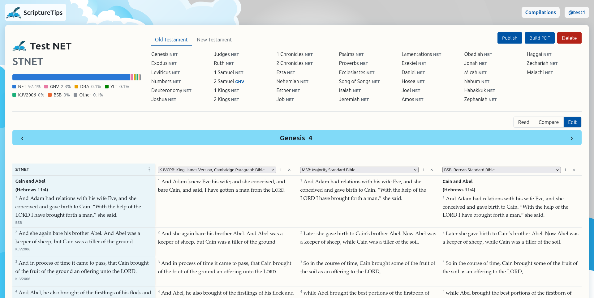

# ScriptureTips

**ScriptureTips lets you design your own Bible and print it: a personalized compilation of your favorite translations, chosen book by book, chapter by chapter and verse by verse.**

Use the advanced study tools to build that compilation, read it, and use it in your online activities through the ScriptureTips browser extension.



*The compilation editor: the compilation's own text on the left, other translations lined up verse by verse beside it, ready to take a verse across.*

Every translation is the work of translators who carefully chose how to carry each thought from the Hebrew, Aramaic and Greek into a new language. ScriptureTips brings that work together in one place, alongside the original-language text, so you can compare translations side by side, study the original words, and choose how each verse is expressed in your own Bible.

## What it does

### Compilations: your own translation

A **compilation** is your preferred translation, made from the translations you trust and put together verse by verse.

- **Start from a base translation**, then make it yours in layers, from broad to narrow: a testament or section, a book, a chapter, a passage, a single verse. The most specific choice always wins.
- **Compare as you go.** Read a chapter on its own, or line it up verse by verse beside as many other translations as you like, even when their verse numbering differs. Click a verse to bring it into your compilation, or take a whole chapter or book in one go.
- **Change the wording where you need to.** You can fix a typing error in a translation, adapt its wording, or write your own rendering of a verse from the original, with a translator's note explaining your choice. Every change is recorded and marked, and credit always goes where it belongs: to the original writer, the translators, and you as the compiler.
- **Publish when you're ready.** Everything stays private until you decide to publish. Each publication is a numbered version with a permanent link, and earlier versions are never overwritten.
- **Licenses are taken care of for you.** Every translation's license terms are stored as data and checked before anything is published or printed, and the attributions each license asks for are added for you.

### Original-language study (planned)

ScriptureTips will include an interlinear view of the Hebrew, Aramaic and Greek, Strong's numbers, lexicons side by side, and word studies that show how each translation rendered a word every time it appears. It will also show Paleo-Hebrew letter forms, and the textual variants between manuscript traditions.

### Scripture links and research (planned)

Scripture links record the connections between passages ("Isaiah 53:4–6 is fulfilled in 1 Peter 2:24"), each with a relationship type and a note explaining it. Links are stored against the original passages, so they appear in every translation. A personal research library holds your own study material, with outside books, articles and videos cited as references.

### The book designer: print your own Bible

The book designer turns a compilation into a Holy Bible you design yourself, ready to print and bind.

- **An edition is a book design**, kept separate from the compilation it prints: trim size, binding, columns, margins and fonts, saved as templates you can reuse. Clone an edition to make a large-print version, or point it at a different compilation.
- **Your own material:** a cover, maps, pictures, notes sections, your studies, research appendices and journaling pages. Everything is anchored to passages rather than pages, so the table of contents, page numbers and "see Map 3" references update by themselves whenever anything moves.
- **Print-ready PDFs** for the interior and the cover (with the spine width worked out for you), with preflight checks and printer profiles, ready for any print-on-demand service or local printer. PDFs are typeset by [Typst](https://typst.app/) in a background worker.
- **A license check runs on every build.**

Building a compilation as a PDF works today. The full designer comes next.

### Browser extension and website plugins (planned)

Scripture references on any web page become links, with a tooltip showing the passage **in your own compilation**.

- **Browser extension:** a rewrite of the ScriptureTips extension already on the Chrome Web Store, released as an update to the same listing. It keeps everything it does now: live page scanning, a link generator (HTML, BBCode, wiki markup and Markdown), your choice of where links open, and switching it off for particular sites. On top of that it adds passage tooltips, support beyond Chrome, and a composer for adding a passage note while you write a post or email.
- **Website widget:** one script tag (or the WordPress plugin) turns the references on a site into links with tooltips, in the site owner's chosen translation, or in the visitor's own compilation if they have the extension. It has a JavaScript API for sites with their own accounts, and it doesn't track visitors.

## Free, and never monetized

ScriptureTips is free and non-commercial, and always will be: no sales, subscriptions, advertising, sponsorship or donations. The Holy Bible should be free to read, and several of the translations it offers (the NET Bible and the Lexham English Bible among them) may only be used in free, non-commercial settings. Staying free is what makes those texts available here. See [the product vision](docs/vision.md) §1.1.

## Status

ScriptureTips is being rebuilt from the ground up as this monorepo, replacing the 2019–2024 prototypes. Built so far:

- accounts with sign-in by emailed code, and a choice of canon (Protestant, Catholic, Orthodox);
- public-domain and openly licensed translations, with verse numbering mapped between versification schemes;
- a reader for translations and compilations;
- the compilation editor, with layered choices, corrections, adaptations and your own renderings backed by authorship evidence, and translator's notes;
- publishing, with an automated license check and consent;
- PDF builds of a compilation.

Next up: the original-language study tools, then the full book designer, then the browser extension and website plugins. The delivery order is in [the product vision](docs/vision.md) §10.

## Running it

Only Docker is needed on your machine. Every other tool runs in the toolbox container:

```bash
./toolbox pnpm install
./dev up              # PostgreSQL, Valkey, Mailpit, Garage, the API, the PDF worker and the web app
./toolbox pnpm --filter @scripturetips/db migrate
./toolbox pnpm verify # lint, formatting, dependency rules, spelling, type checks and tests
```

The web app is at http://127.0.0.1:3000, and sign-in emails arrive in Mailpit at http://127.0.0.1:8025. Translation texts are imported separately (see [tools/scripture-import](tools/scripture-import/AGENTS.md)).

## Documentation

- [Product vision](docs/vision.md)
- [Domain model](docs/domain-model.md)
- [Book designer](docs/book-designer.md)
- [Licensing survey](docs/licenses.md)
- [Translation and data sources](docs/sources.md)
- [Testing and agent verification](docs/testing.md)
- [Branding](docs/branding.md)

## License

[GNU Affero General Public License v3.0](LICENSE). Each translation keeps its own license; see [the licensing survey](docs/licenses.md).
